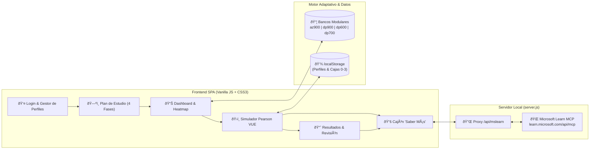

<div align="center">

# 🎓 MS Student Platform
### Simulador Adaptativo de Certificaciones Microsoft Cloud, Data & Fabric
**Entorno fiel a Pearson VUE • Repetición Espaciada Inteligente • Conectado en Vivo a Microsoft Learn MCP**

[](./LICENSE)
[](./index.html)
[](./data/questions.json)
[](./data/az900.json)
[](./data/dp900.json)
[](./data/dp600.json)
[](./data/dp700.json)
[](https://learn.microsoft.com/api/mcp)

**🌐 Demo en vivo:** https://joangranell.github.io/MS-Student-Platform/

</div>

---

## 🌟 ¿Qué es MS Student Platform?

**MS Student Platform** es una **Single Page Application (SPA)** estática sin dependencias externas pesadas, diseñada para preparar con rigor técnico las certificaciones oficiales de **Microsoft Azure y Microsoft Fabric**.

Combina **dos mundos en una sola herramienta**:
1. **🏛️ Modo Examen Oficial (Simulación Pearson VUE):** Reproduce la estética, presión de tiempo, reglas de navegación y tipologías de preguntas reales (opción única `○`, selección múltiple `☐` con bloqueo de límite, tachado de opciones descartadas con clic derecho, casos de estudio con pestañas laterales y nota escalada oficial de **100 a 1000 puntos**, corte **700 = 70%**).
2. **🧠 Modo Estudio Adaptativo + Cajón "📚 Saber Más":** Un tutor inteligente basado en **Cajas de Repetición Espaciada (Leitner 0–3)** y **Detección de Debilidad por Tecnología**, que prioriza automáticamente los temas que más fallas e incluye fichas teóricas estructuradas y conexión en tiempo real al servidor **MCP de Microsoft Learn (`https://learn.microsoft.com/api/mcp`)**.

---

## 🏆 Certificaciones Incluidas (240 Preguntas Originales)

| Código | Certificación Oficial | Nivel | Preguntas | Archivo Modular | Temáticas Clave |
| :--- | :--- | :---: | :---: | :--- | :--- |
| **AZ-900** | **Microsoft Azure Fundamentals** | *Fundamentals* ★ | **100** | [`data/az900.json`](./data/az900.json) | Cloud Concepts, IaaS/PaaS/SaaS, VMs, Containers, VNets, VPN/ExpressRoute, Storage, Entra ID, RBAC, Cost Management, Policy, ARM/Bicep, Monitor. |
| **DP-900** | **Microsoft Azure Data Fundamentals** | *Fundamentals* ★ | **70** | [`data/dp900.json`](./data/dp900.json) | ACID/OLTP vs OLAP, Parquet/Avro/ORC, Azure SQL (DTU/vCore/Hyperscale), Cosmos DB, Blob Storage, Data Factory, Synapse, Fabric, Power BI. |
| **DP-600** | **Fabric Analytics Engineer Associate** | *Associate* ★★ | **35** | [`data/dp600.json`](./data/dp600.json) | Lakehouses, Warehouses, Direct Lake & Fallback, Modelos Semánticos Star Schema, DAX avanzado, Calculation Groups, XMLA, RLS/OLS/CLS, CI/CD & Git. |
| **DP-700** | **Fabric Data Engineer Associate** | *Associate* ★★ | **35** | [`data/dp700.json`](./data/dp700.json) | Real-Time Intelligence, Eventstreams, Eventhouse (KQL `arg_max`, `mv-expand`), PySpark, Delta Lake (`MERGE`, `OPTIMIZE`, `VACUUM`), `notebookutils`, Spark Tuning. |

---

## ✨ Características Principales

### 👤 1. Pantalla de Login Multi-Perfil y Plan de Estudio a Medida
- **Múltiples perfiles sin contraseña (`localStorage`):** Cada usuario mantiene aislado su historial, estadísticas por dominio y caja de repetición.
- **Gestión en línea (`🛠️ Ver perfiles`):** Permite renombrar perfiles, cambiar su certificación objetivo o eliminarlos, además de exportar/importar copias de seguridad en `.json`.
- **Plan de Estudio en 4 Fases Progresivas:** Al iniciar un perfil y elegir tu **Certificado Objetivo**, la plataforma construye tu hoja de ruta dividida en:
  1. *Fase 1 • Cimientos (`🟢 Fundamentos y Conceptos`)*
  2. *Fase 2 • Consolidación (`🔄 Estudio Adaptativo por Dominios`)*
  3. *Fase 3 • Nivel Experto (`🔴 Casos de Estudio y Código`)*
  4. *Fase 4 • Validación Final (`🏛️ Simulacro Oficial Pearson VUE`)*

### 🧠 2. Motor de Repetición Adaptativa y Mapa de Calor Visual
- **Sistema de Cajas 0 a 3:** Cuando fallas una pregunta, entra en la **Caja 0 (Prioridad Crítica)** y vuelve a aparecer en tus sesiones hasta que la aciertes de forma consistente.
- **Refuerzo por Tema Débil:** Si fallas una pregunta sobre *Direct Lake*, *KQL* o *Azure Networking*, el motor adaptativo incrementa la probabilidad de extraer **otras preguntas del mismo tema** para asegurar que dominas el concepto y no solo memorizas una letra.
- **Mapa de Calor con Iconos Vectoriales:** Visualiza de un vistazo tu porcentaje de dominio en cada tecnología y lanza un entrenamiento focalizado en 1 clic.

### 📚 3. Botón "Saber Más" + Consulta en Vivo a Microsoft Learn MCP
- Cada pregunta cuenta con una **Ficha Teórica (`theoryPill`)** que resume la arquitectura del servicio, los puntos clave para el examen y la alerta **"⚠️ Trampa frecuente en Pearson VUE"**.
- Desde el mismo cajón lateral puedes interrogar en vivo a `https://learn.microsoft.com/api/mcp` para buscar artículos oficiales (`microsoft_docs_search`) y fragmentos de código (`microsoft_code_sample_search`) sin abandonar el test.

### 🌗 4. Modo Oscuro y Modo Claro (Fluent UI)
- Alterna en cualquier momento entre **Fluent Dark Mode** (por defecto) y **Fluent Light Mode** desde la barra superior.

---

## 🏗️ Arquitectura del Sistema



---

## 🚀 Instalación y Puesta en Marcha

No necesitas instalar paquetes pesados ni compiladores. Solo necesitas tener **Node.js** instalado (o cualquier servidor estático local):

### Opción A: Con soporte en vivo para el MCP de Microsoft Learn (Recomendado)

1. Clona el repositorio:
   ```bash
   git clone https://github.com/joangranell/MS-Student-Platform.git
   cd MS-Student-Platform
   ```
2. Inicia el servidor local (en Windows puedes hacer doble clic en `iniciar-plataforma.bat`):
   ```bash
   node server.js
   ```
3. Abre tu navegador en:
   👉 **`http://localhost:8080`**

*(También puedes consultar la especificación técnica interactiva en `http://localhost:8080/documento-funcional.html`).*

### Opción B: Despliegue Estático (GitHub Pages / Netlify / Vercel)
La aplicación funciona 100% como SPA estática sirviendo la raíz del repositorio. En entornos puramente estáticos sin `server.js`, todas las preguntas, explicaciones, fichas teóricas *"Saber más"* y enlaces directos a Microsoft Learn funcionan de manera autónoma.

---

## 📂 Estructura del Proyecto

```text
MS-Student-Platform/
├── index.html                  # Aplicación SPA principal
├── documento-funcional.html    # Documento funcional y técnico interactivo
├── server.js                   # Servidor estático Node.js + Proxy para MS Learn MCP
├── iniciar-plataforma.bat      # Lanzador rápido en 1 clic (Windows)
├── LICENSE                     # Licencia MIT + Aviso de Marcas Registradas
├── css/
│   ├── variables.css           # Paletas Fluent Dark y Fluent Light
│   ├── main.css                # Estilos de Login, Plan de Estudio, Dashboard y Heatmap
│   └── exam-vue.css            # Estilos Pearson VUE, Casos de Estudio y Cajón "Saber Más"
├── js/
│   ├── app.js                  # Controlador principal y orquestador de eventos
│   ├── state.js                # Estado reactivo de la sesión
│   ├── storage.js              # Persistencia Multi-Perfil y Cajas de Repetición (localStorage)
│   ├── examEngine.js           # Motor adaptativo, barajado Fisher-Yates y evaluación 100-1000
│   ├── ui.js                   # Renderizado DOM de vistas y modales
│   └── icons.js                # Escudos de certificación e iconos de servicios en SVG
├── data/
│   ├── az900.json              # 100 preguntas de AZ-900: Azure Fundamentals
│   ├── dp900.json              # 70 preguntas de DP-900: Azure Data Fundamentals
│   ├── dp600.json              # 35 preguntas de DP-600: Fabric Analytics Engineer
│   ├── dp700.json              # 35 preguntas de DP-700: Fabric Data Engineer
│   └── questions.json          # Catálogo unificado (240 preguntas)
└── scripts/
    └── mcp-mslearn.js          # Conector JSON-RPC/SSE hacia https://learn.microsoft.com/api/mcp
```

---

## ⚖️ Aviso Legal, Propiedad Intelectual y No Afiliación

> **Proyecto Educativo Independiente (Cero "Braindumps"):**
> * **MS Student Platform** es una herramienta de software libre (Licencia MIT) creada exclusivamente con fines educativos y de autoestudio.
> * **Contenido 100% Original:** Todas las preguntas, casos prácticos, explicaciones y fichas teóricas de este repositorio son ejercicios originales redactados a partir de la documentación pública de [Microsoft Learn](https://learn.microsoft.com/) y de las guías de estudio públicas (*Study Guides*). Este repositorio **no contiene ni permite** preguntas filtradas o protegidas por el Acuerdo de Confidencialidad de Exámenes de Microsoft (*Microsoft Certification Exam NDA*).
> * **No Afiliación y Marcas Registradas:** Este proyecto **no está afiliado, patrocinado, autorizado ni respaldado oficialmente por Microsoft Corporation ni por Pearson Education, Inc. (Pearson VUE)**. *Microsoft, Azure, Microsoft Fabric, OneLake, Power BI y Microsoft Entra* son marcas comerciales o marcas registradas de Microsoft Corporation. *Pearson VUE* es una marca registrada de Pearson Education, Inc. Su mención en este proyecto responde exclusivamente a un uso descriptivo y nominativo legítimo para identificar el temario de estudio.
> * **Privacidad (RGPD / GDPR):** La aplicación almacena el progreso y los perfiles únicamente en el `localStorage` del navegador local del usuario y no recopila datos personales en servidores externos.

